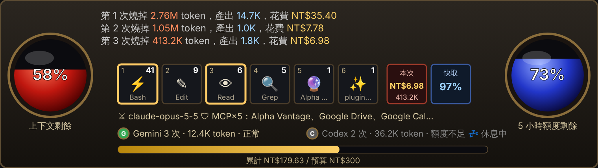

# cc

fairy715 的 Claude Code mods（外掛）。

| mod | 說明 |
|---|---|
| [token-meter](token-meter/) | 暗黑破壞神風格的 token HUD：每次送出燒掉多少 token、花多少錢（美元＋台幣）、上下文與額度還剩多少，自動顯示在輸入框上方與每則回覆下方 |



## 安裝

在終端機的 Claude Code 或桌面版 Code 分頁輸入：

```
/plugin marketplace add fairy715/cc
/plugin install token-meter@fairy715-mods
```

更新：`/plugin update token-meter@fairy715-mods`，再 `/reload-plugins`。

詳細說明見各 mod 資料夾內的 README。
