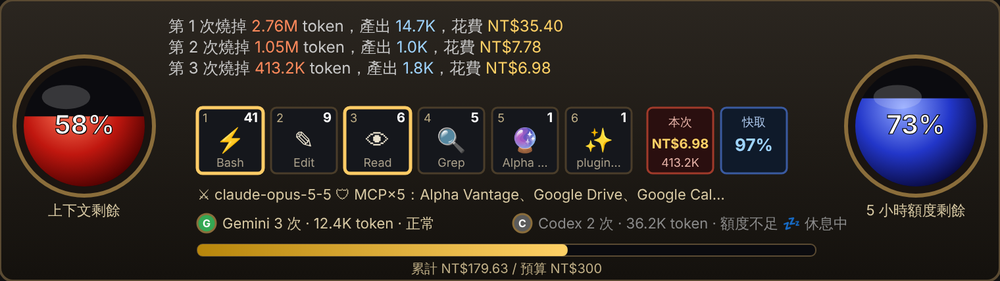

# cc

fairy715 的 Claude Code mods（外掛）｜ Claude Code mods by fairy715

| mod | 說明 | Description |
|---|---|---|
| [token-meter](token-meter/) | 暗黑破壞神風格的 token HUD：每次送出燒掉多少 token、花多少錢（美元＋台幣）、上下文與額度還剩多少，外援 AI（Gemini、Codex）用了多少，自動顯示在輸入框上方與每則回覆下方 | A Diablo-style token HUD: tokens and cost (USD and NT$) per send, context and quota left, and external AI (Gemini, Codex) usage, shown above the prompt and under every reply |
| [ai-office](ai-office/) | AI Agent 虛擬辦公室：浮島上的 3D 網頁，每個專案一間房，AI 成員在房間之間走動，可看狀態、批准、派工。不是外掛，用瀏覽器開；目前是示範資料 | A 3D virtual office for AI agents: a web page with one room per project on a floating island, agents walking between them, status, approve and assign. Not a plugin, opens in a browser; demo data for now |
| [block-strike](block-strike/) | 方塊突擊：方塊人風格的網頁版 5 對 5 爆破模式射擊遊戲，單機對電腦，三張原創地圖。不是外掛，用瀏覽器開 | Block Strike: a blocky browser FPS, 5v5 bomb defusal against bots on three original maps. Not a plugin, opens in a browser |



## 安裝 ｜ Install

在終端機的 Claude Code 或桌面版 Code 分頁輸入 ｜ In Claude Code in a terminal, or the desktop app's Code tab:

```
/plugin marketplace add fairy715/cc
/plugin install token-meter@fairy715-mods
```

更新 ｜ Update：`/plugin update token-meter@fairy715-mods`，再 ｜ then `/reload-plugins`

## 說明文件 ｜ Docs

| | 繁體中文 | English |
|---|---|---|
| token-meter 說明 ｜ token-meter guide | [README](token-meter/README.md) | [README](token-meter/README.en.md) |
| 外援 AI（傭兵）教學 ｜ External AI (mercenaries) guide | [mercenaries.md](token-meter/docs/mercenaries.md) | [mercenaries.en.md](token-meter/docs/mercenaries.en.md) |
