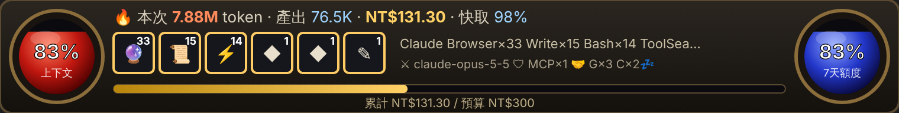

# token-meter

English ｜ [繁體中文](README.md)

A Claude Code mod: a Diablo-style token HUD. How many tokens each send burns, what it costs (USD and NT$), how much context and quota is left, and how much your external AIs used, shown automatically with nothing to call.


> The HUD's own text is in Traditional Chinese; this page translates each part.

## What you see

- **A line under every reply** (automatic): `🔥 本次 413.2K token · NT$6.98 · 🔴 上下文剩 58% · 🔵 5 小時額度剩 73% · 💰 累計 NT$179.63 · ⚔ ⚡Bash×3 👁Read×2`
  - This send's tokens and cost · context left · 5-hour quota left · session total · the tools **this send** used and how often (up to 4), not the session's totals
  - When the send dispatched to external AIs, it ends with `🤝 Gemini×1 Codex×1（Codex 額度不足）` (Codex out of quota)
- **`/hud` (full HUD)**: draws the picture HUD (above) in the conversation, updated after every send, but it scrolls away with the conversation; also tries to open a side pane (`/hud off` closes it). It holds:
  - 🔴 **Red orb = context left**: when the context runs out, Claude compacts the conversation
  - 🔵 **Blue orb = quota left**: the tighter of the 5-hour and 7-day windows; without quota data, what is left of your budget
  - **Battle log**: the last 3 sends — tokens burned, tokens produced, cost
  - **Skill bar 1–6**: the session's most used tools, skills (✨) and MCP servers (🔮) with their **session** counts; those the latest send used get a gold frame
  - **Potions**: this send's cost and cache hit rate
  - **Gear**: ⚔ model, 🛡 connected MCP servers
  - **Mercenaries**: external AI calls, tokens and status, e.g. `Gemini 3 次 · 12.4K token · 正常` (3 calls · 12.4K tokens · OK); greyed with "💤 休息中" (resting) while out of quota
  - **Experience bar**: session spend / budget
  - SVG on desktop and mobile, text in the terminal
- **Above the prompt (slim HUD, stays put while you scroll)**: a 96px picture HUD on desktop, one line of text in the terminal

  

  - Small orbs, this send's tokens / output / cost / cache hit rate, 6 skill slots (icon and session count, gold frame for the latest send), the most used tool names, model and MCP count, mercenaries (`🤝 G×3 C×2`, 💤 means out of quota), budget bar
  - Compared with the full HUD: no 3-send battle log, no names in the skill slots, only the MCP count in the gear; type `/hud` for the details
- **Status line**: `本次 US$0.2188（NT$6.98） ｜ 累計 US$5.6310（NT$179.63）` (this send | session total)
- **`/tokens`**: a markdown report of the last 10 sends; the last column, "外援", lists the external AI calls of each send (e.g. `G1 C1`)

## How it counts

- Tokens: every API response during a send, summed (main conversation and subagents). "Input" = uncached input + cache reads + cache writes.
- Cost: Claude Code's own cost ledger (the same figure as `/cost` and the status line), the difference between before and after the send, so subagents and caching are included.
- On a subscription (Pro/Max) this is the equivalent API price, not what you are charged.

## External AI (mercenaries)

👉 **Full guide (installing Gemini / Codex, signing in, having Claude dispatch, reading the HUD): [docs/mercenaries.en.md](docs/mercenaries.en.md)**

Let Claude hand parts of a task to Gemini and Codex; the HUD shows their usage as mercenaries. Each `agy -p …` (Gemini) or `codex exec …` (Codex) Claude runs in Bash counts as a call, and the run folders under `~/ai-dispatch/runs/` created since the session started give the usage:

- **Gemini**: `status` and `usage` in `gemini/result.json` (understands `total_tokens`, `totalTokenCount`, `input_tokens` + `output_tokens` and similar; otherwise shows calls only)
- **Codex**: the trailing `tokens used` in `codex/stderr.log`
- **Out of quota**: quota, rate limit, 429 and the like in the error output; a toast at most once a day per AI
- Only Claude's dispatches count; running `agy` or `codex` yourself does not
- Calls and tokens only, no money (Gemini runs on a subscription, Codex on a free plan)

## NT$ exchange rate

- By default the live USD/TWD rate is fetched from `open.er-api.com` when a session starts (`/tokens` marks it "即時", live).
- When that fails (offline, blocked by a company network) or the live rate is off, the configured rate is used, 31.9 by default (marked "設定值", configured).

## Settings (`/config` → token-meter)

- `twdRate`: fallback rate (NT$ per US$), default 31.9
- `liveRate`: fetch the live rate, default on
- `budgetTwd`: this session's budget in NT$, for the experience bar and the blue orb's fallback, default 300
- `replyLine`: the line under every reply, default on
- `autoOpen`: open the HUD pane when a session starts, default on

## Turning it off

- Close the pane: `/hud off` (`/hud` opens it again)
- Stop it opening every session: `/config` → token-meter → turn off `autoOpen`
- Drop the line under replies: `/config` → token-meter → turn off `replyLine`
- Disable the mod: `/plugin disable token-meter@fairy715-mods` (`/plugin enable` restores it)

## Install

In Claude Code in a terminal, or the desktop app's Code tab:

```
/plugin marketplace add fairy715/cc
/plugin install token-meter@fairy715-mods
```

Choose the user scope so every session loads it.

## Update

```
/plugin update token-meter@fairy715-mods
/reload-plugins
```

## Where it works

- **Desktop app, Code tab**: picture HUD (orbs, skill bar, gear)
- **Claude Code in a terminal**: text HUD
- **Cloud sessions (claude.ai/code, mobile remote)**: the hooks run but nothing is drawn; use `/tokens`
- **Cowork**: not listed among the surfaces mods support

## Known limits

- **History lives in memory**: restarting Claude Code clears the `/tokens` history and skill counts; the session total is unaffected (it is Claude Code's own ledger).
- **The budget includes spend from before the mod loaded**: the blue orb's budget and the experience bar use the session's whole spend, so when the mod loads mid-session part of the budget may already be gone, and it will not match the `/tokens` rows.
- **The pane may not show**: below 144 terminal columns it does not open by itself (type `/hud`); some surfaces draw no pane, so use the area above the prompt or the line under replies.
- **At most 200 sends are kept**: older ones are dropped, and numbering carries on.
